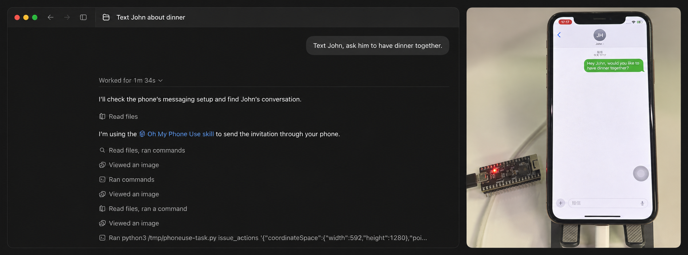
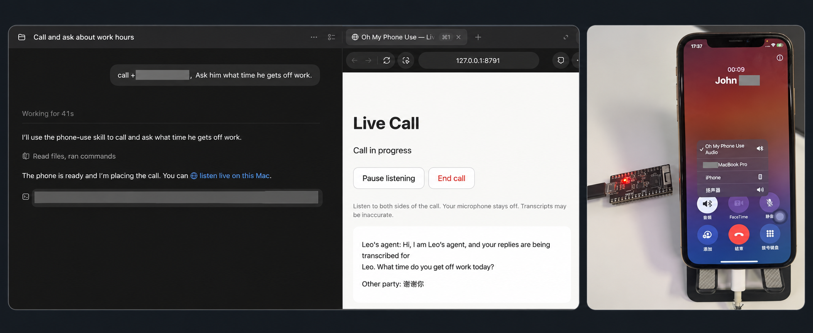

# Oh My Phone Use

Let an AI agent use a real iPhone or iPad: see the screen, tap, type and scroll, and make phone
calls that speak and listen on your behalf.

A small ESP32 board is the agent's hands. It acts as a Bluetooth mouse + keyboard for the phone
and as its Bluetooth hands-free unit (car kit) for calls. An app on the phone shares the screen.
No jailbreak and no private APIs: the phone only sees an ordinary Bluetooth accessory.

## Two ways to use it

1. **With your agent** (works today): Claude or any other MCP client connects to one MCP server
   on your Mac and gets screen-control tools and phone-call tools, plus a
   [skill](skills/oh-my-phone-use/SKILL.md) that teaches it how to use them safely.
2. **Standalone phone app** (planned): the app on the phone drives the phone and conducts calls
   by itself, without a Mac. See [Roadmap](#roadmap).

```
                         ┌─────────────── Mac ───────────────┐
Agent (Claude, …) ──MCP──▶ MCP server ─┬─▶ control server ◀──┼── WebSocket ── phone app (screen sharing)
                         │             └─▶ phone service ────┼── USB serial ──┐            │
                         └───────────────────────────────────┘                │       HTTP over Wi-Fi
                                                                              ▼            ▼
                                                     iPhone / iPad ◀── Bluetooth ── ESP32 board
                                                     (mouse + keyboard, hands-free calls)
```

## Use case 1: Let an agent control your phone

Let your agent see your phone's screen, tap, type and scroll to carry out tasks
in its apps. The example below shows Codex using the Oh My Phone Use skill to
send a dinner invitation through the iPhone's Messages app.



*The images are combined for presentation.*

## Use case 2: Let an agent make phone calls

Give your agent a phone number and a task. It can call through your iPhone,
speak and listen on your behalf, while you follow the conversation on the live
listening page. The example below shows a call asking John what time he gets
off work, with the iPhone routing call audio through the ESP32.



*The images are combined for presentation, with the phone number and personal
details hidden. The screenshot shows a call in progress; transcripts may be inaccurate.*

## Status

The repository structure and APIs are currently unstable and may change without
backward compatibility as the project evolves.

| Capability | State |
| --- | --- |
| Screen control through MCP (`get_screen`, `issue_actions`) | Works with the default firmware build; pointer calibration in the app |
| Phone calls through MCP (`phone_*`) | Works with the HFP firmware build: dial or attach, spoken turns (macOS `say`), local transcription (whisper.cpp), hangup, saved results |
| Both at the same time on one board | Not yet: the ESP32-PICO-V3 lacks the RAM for Wi-Fi + HFP + BLE HID together |
| Standalone app | Planned |

## Quick start (with your agent)

You need an ESP32-PICO-KIT-1 (classic ESP32), a Mac with ESP-IDF v6.1, Python 3.10+,
Node.js 20+, full Xcode and an Apple signing team, and an iPhone or iPad running
iOS/iPadOS 17 or later. This is the app's deployment target, not a claim that every
supported OS version has been tested; see the [device testing notes](ios/README.md#build-and-install).
The current phone-call speech path uses macOS `say`; Linux and Windows are not validated
for the complete setup. Screen control and calls require different firmware builds on
the current board, as described in [Status](#status).

1. **Firmware**: build and flash it, pair the phone over Bluetooth, and on an iPhone enable
   AssistiveTouch ([firmware/README.md](firmware/README.md#build-and-flash)):

   ```bash
   idf.py -C firmware set-target esp32
   idf.py -C firmware build
   idf.py -C firmware -p /dev/cu.usbserial-XXXXX -b 230400 flash
   ```

2. **Control server and MCP server** (the first start creates the input-device secret):

   ```bash
   npm ci --prefix host/control_server
   npm run start:background --prefix host/control_server
   npm run calibration:background --prefix host/control_server
   npm run mcp:background --prefix host/control_server        # http://127.0.0.1:8780/mcp
   ```

3. **Provision the board** with that secret and the Wi-Fi network the phone uses; the script
   prints the board's address (`phoneuse.local` or an IP):

   ```bash
   python3 -m venv .venv && .venv/bin/pip install -r host/tools/requirements.txt
   bash host/tools/provision.sh /dev/cu.usbserial-XXXXX "Wi-Fi SSID" "password"
   ```

4. **Install the app** ([ios/README.md](ios/README.md)): copy
   `ios/.signing.env.example` to `ios/.signing.env`, set your team ID and a unique
   bundle ID, then

   ```bash
   bash ios/scripts/build.sh -allowProvisioningUpdates
   xcrun devicectl list devices
   bash ios/scripts/install.sh YOUR_DEVICE_ID
   ```

   In the app, enter `http://phoneuse.local` as the input tool, `ws://YOUR_MAC_IP:8765/device`
   as the control server, run the pointer calibration, then tap **Start Session** and confirm
   **Start Broadcast**.

5. **Connect your agent** to the MCP server and give it the skill. For Claude Code:

   ```bash
   claude mcp add --transport http oh-my-phone-use http://127.0.0.1:8780/mcp
   cp -R skills/oh-my-phone-use ~/.claude/skills/
   ```

   Ask it to do something on the phone. Quick check without an agent:
   `node host/control_server/client.js screen` saves a screenshot under
   `host/control_server/.state/`.

**Phone calls** need the HFP firmware build and the phone service on the Mac; see
[host/README.md](host/README.md#phone-service). When a step does not behave as described,
[docs/troubleshooting.md](docs/troubleshooting.md) lists the symptoms and their fixes.

The MCP server and the control server have no authentication: keep them on loopback or a
private network ([SECURITY.md](SECURITY.md)). A call reaches a real person: the skill makes the
agent dial only numbers you gave it, introduce itself using your preferred name or the
available context, explain that replies are transcribed for you, and confirm what it heard.

## Repository layout

| Path | What |
| --- | --- |
| [`firmware/`](firmware/README.md) | ESP-IDF firmware: BLE HID mouse + keyboard, Wi-Fi input tool, HFP hands-free unit, host tests |
| [`host/`](host/README.md) | Mac side: unified MCP server and control server (`host/control_server/`, Node), phone service and serial tools (`host/tools/`, Python) |
| [`ios/`](ios/README.md) | iPhone/iPad app: screen sharing (ReplayKit), sessions, pointer calibration, forwards input to the board |
| [`skills/oh-my-phone-use/`](skills/oh-my-phone-use/SKILL.md) | Skill for agents that use the MCP server |
| [`docs/`](docs/) | [Input tool HTTP protocol](docs/input_protocol.md) between the app, the control server and the board; [troubleshooting](docs/troubleshooting.md) by symptom. The other protocols are documented next to their implementation: serial in [firmware/README.md](firmware/README.md#serial-protocol), control server in [host/control_server/PROTOCOL.md](host/control_server/PROTOCOL.md) |
| [`AGENTS.md`](AGENTS.md) | Conventions for coding agents and contributors changing this repository (one per component as well) |

## Development

```bash
make -C firmware/test/host test                           # firmware logic, no hardware
npm test --prefix host/control_server                     # control server, MCP server, calibration
.venv/bin/python -m unittest discover -s host/test/phone    # phone service, simulated board
bash ios/scripts/test_relay.sh                            # app relay against the control server
bash ios/scripts/test_frames.sh                           # fresh-frame selection
bash ios/scripts/test_setup.sh                            # setup-step status
bash ios/scripts/test_session_launch.sh                   # Start Session intent hand-off
bash ios/scripts/test_calibration_click.sh                # calibration click policy
```

Run these from the repository root after installing the Node and Python dependencies above.
The Swift harness scripts require an Apple Silicon Mac running macOS 14 or later, Xcode
command-line tools and Node.js 20+; four scripts currently compile for `arm64-apple-macosx14.0`.
They use simulated peers and need no phone, board or signing credentials. The Node-only suite
skips the native relay test; `test_relay.sh` builds the Swift harness and runs that test too.
These tests do not replace an iOS app build or the firmware's
[hardware acceptance test](firmware/README.md#testing).

## Roadmap

- **Calls and screen control together**: an ESP32 module with PSRAM (for example ESP32-WROVER;
  the ESP32-S3/C3 lack Classic Bluetooth and cannot do HFP) to run Wi-Fi, HFP and BLE HID at
  once.
- **Call control and audio over Wi-Fi**: a network protocol on the board for calls, replacing the
  USB serial link, so that the Mac and the phone app use the same board API.
- **Standalone app**: the agent loop, screen control and calls in the phone app, sharing test
  vectors with the control server's action compiler and calibration.
- **Rust migration**: migrate the Node.js control server and MCP server in
  `host/control_server/`, and the Python tools and phone service in `host/tools/`, to Rust.

## Credits and license

The screen-control design, the phone app and the control server come from
[jamiepinheiro/ipad_computer_use](https://github.com/jamiepinheiro/ipad_computer_use) (MIT),
where a USB Seeed XIAO RP2040 is the input tool; this project replaces it with the ESP32 and
keeps the parts it needs. [THIRD_PARTY.md](THIRD_PARTY.md) lists the derived files and keeps
the upstream copyright notice. The tag `upstream-ac07704` marks the commit that imported the
upstream snapshot.

Oh My Phone Use is released under the [MIT License](LICENSE).
